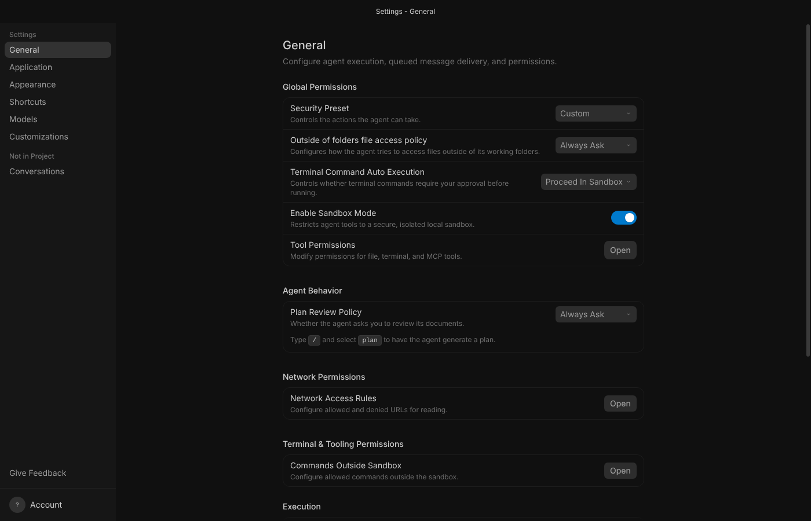
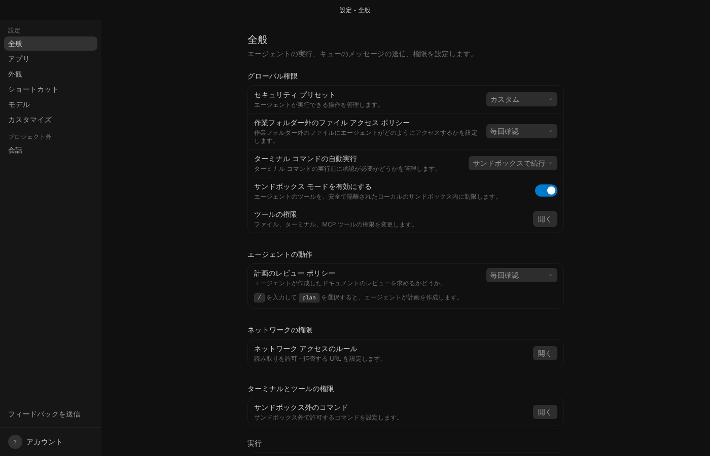

# Antigravity 日本語化

Google **Antigravity 2.x デスクトップアプリ**の画面を日本語にします。いつでもワンクリックで公式の英語版に戻せます。（中国語版の説明は [README.md](README.md)）

| 公式の英語版 | 日本語化後 |
| --- | --- |
|  |  |

## 特長

- **実際の画面の文言から翻訳**：Antigravity 2.29.0 の公式インストーラーに埋め込まれている画面プログラムから文言を 1 つずつ抽出し、約 3,960 項目（テキスト 3,292、変数を含む文型 604、ボタンやコードを挟む文 64）を翻訳しました。訳語は [用語集](docs/用語集-ja.md) でそろえています。
- **変更するのは 1 ファイルだけ**：`resources\app.asar` のみ。変更前に公式版をバックアップし、元に戻すとバイト単位で公式版と同一になります。
- **追加のインストール不要**：Node.js や Python は不要です。Antigravity に内蔵の実行環境を使います。
- **ネットワーク通信なし**：ツールもパッチも、何もダウンロード・アップロードしません。コードはすべてこのフォルダーにあり、1 行ずつ確認できます。
- **確実でないものは訳さない**：文全体が一致したときだけ置き換えるので、英語と日本語が混ざった不自然な文になりません。入力欄、エディタ、ターミナル、コード、エージェントの応答、自分が送ったメッセージは変更しません。

## 使い方（Windows）

1. このリポジトリをダウンロードし（GitHub の **Code → Download ZIP**）、好きな場所に展開します。
2. `antigravity-l10n` フォルダーを開き、**`日本語化.bat`** をダブルクリックします。
   - Antigravity が起動している場合は、先に終了するか確認されます。`Y` を入力してください（実行中の会話は中断されます）。
   - 完了後、すぐに Antigravity を起動するか確認されます。
3. 英語に戻すとき：**`英語に戻す.bat`** をダブルクリックします。
4. 現在の状態を確認するとき：**`状態を確認.bat`** をダブルクリックします。

「Windows によって PC が保護されました」と表示された場合（ファイルがインターネットから取得されたため）、**詳細情報 → 実行** をクリックしてください。展開する前に ZIP を右クリック → **プロパティ** → **許可する** にチェックを入れておくと表示されなくなります。

Antigravity は既定で `%LOCALAPPDATA%\Programs\antigravity` にインストールされ、ツールが自動的に見つけます。別の場所にある場合は、PowerShell で `Antigravity.exe` があるフォルダーを指定してください：

```powershell
powershell -NoProfile -ExecutionPolicy Bypass -File scripts\agzh.ps1 -Command apply -Locale ja -InstallDir "D:\Apps\Antigravity"
```

簡体字中国語の画面にしたい場合は `汉化.bat` を使います。日本語と中国語は、英語に戻さずにそのまま切り替えられます。

## 公式のアップデート後

Antigravity が自動アップデートすると `app.asar` が置き換わり、画面は英語に戻ります。**もう一度 `日本語化.bat` を実行**すれば数秒で日本語に戻ります。ツールが新しいバージョンを認識し、バックアップも新しい公式版に置き換えます。

新しいバージョンで追加された文言は、しばらく英語のまま表示されます。文全体で一致させているため、古い辞書が新しい画面を誤訳することはありません。

## 翻訳しないもの・既知の制限

- **エージェントが何語で応答するか**は画面の日本語化とは関係ありません。日本語で応答させたい場合は、**設定 → カスタマイズ** で「常に日本語で応答してください」のようなルールを追加してください。
- モデル名・製品名（Gemini、Claude、Google Chrome など）、キー名（Ctrl、Shift）は英語のままです。
- ウィンドウのメニュー（File / Edit / View…）は翻訳しません。Windows 版ではメニューバーが非表示で、公式のコードが英語の名前でメニューを探しているため、変えると不具合が出ます。
- 設定画面などの**検索欄**で絞り込むときは、英語のキーワードを入力してください（絞り込みは画面プログラム内部で英語に対して行われます）。
- 文中にボタンや変数が入る一部の文は、元の配置の制約で語順が少し不自然になることがあります。
- Google 社内版だけの機能（CitC、Cog、ABFS、Piper など）は翻訳していません。
- 対象は Antigravity 2.x デスクトップアプリのみです。旧 Antigravity IDE（VS Code ベース）には対応していません。

## 動作確認

- 辞書・パッチ・翻訳スクリプトは **Antigravity 2.29.0 公式 Linux 版**で実際に動かして確認しました。パッチ適用後も正常に起動し、ログイン画面、設定画面の各タブ、IDE 移行ウィザード、トレイメニューを確認済みで、ページのエラーはありません。
- Windows 版 2.29.0 の `app.asar` と埋め込みの画面プログラムは Linux 版と**バイト単位で同一**です（公式インストーラーで比較。SHA-256 は winget のマニフェストと一致）。
- `日本語化.bat` から呼び出す PowerShell スクリプトは、PowerShell 7 で「起動中のアプリを検出 → 終了 → 適用 → 元に戻す」までの一連の流れを確認しました。**実際の Windows ではまだ実行していません**。初回はメッセージに注意してください。問題があっても、`英語に戻す.bat` か公式 Antigravity の再インストールで元に戻せます。
- `npm test` で 18 項目の自動テストを実行できます。

## 仕組み

Antigravity 2.x の画面は、ローカルの `language_server` が配信するウェブページを Electron が読み込んで表示しています。パッチは `app.asar` 内の次の 3 か所を変更します。

| 場所 | 変更内容 |
| --- | --- |
| `dist/preload.js` | 末尾に翻訳スクリプトと辞書を追加します。ページの読み込み前に（ページのスクリプトから触れない分離環境で）実行され、`MutationObserver` で画面の変化を監視して、辞書に一致した文字列を置き換えます。変更するのはテキストと `placeholder`、`title`、`alt` 属性だけで、要素の追加・削除・移動は行いません。 |
| `dist/main.js` | 1 行目で `dist/agzh/main-hook.js` を読み込み、トレイメニュー、右クリック メニュー、システム ダイアログ、システム通知を翻訳します。 |
| `dist/agzh/` | メインプロセス用の翻訳処理、辞書、パッチ情報。 |

安全面：

- ツールが読み書きするのは `resources\app.asar` とバックアップ `resources\app.asar.agzh-original` の 2 つだけで、書き込みの前後に検証します。
- `app.asar` がすでに他の日本語化・中国語化ツールで変更されている場合は処理を拒否し、他人の変更を「公式版」としてバックアップしないようにしています。
- Antigravity 内蔵の実行環境を使う前に、Electron の `RunAsNode` 設定がオンになっていることを確認します。オフの場合はシステムの Node.js を使い、誤って Antigravity 本体を起動することはありません。

## 辞書のメンテナンス

日本語の辞書は `locales/ja/` にあります（形式は中国語版と同じで、詳しくは [README.md](README.md) の「维护词典」を参照）。新しいバージョンで未翻訳の文言を探すには：

```bash
cd tools && npm install && cd ..
node tools/extract-webui.js "%LOCALAPPDATA%\Programs\antigravity\resources\bin\language_server.exe" webui
node tools/find-untranslated.js webui/main.js untranslated-ja.json ja
```

## ライセンス

コードと訳文は MIT ライセンスです。画面の英語原文の著作権は Google に帰属します。このプロジェクトは Google とは関係ありません。
