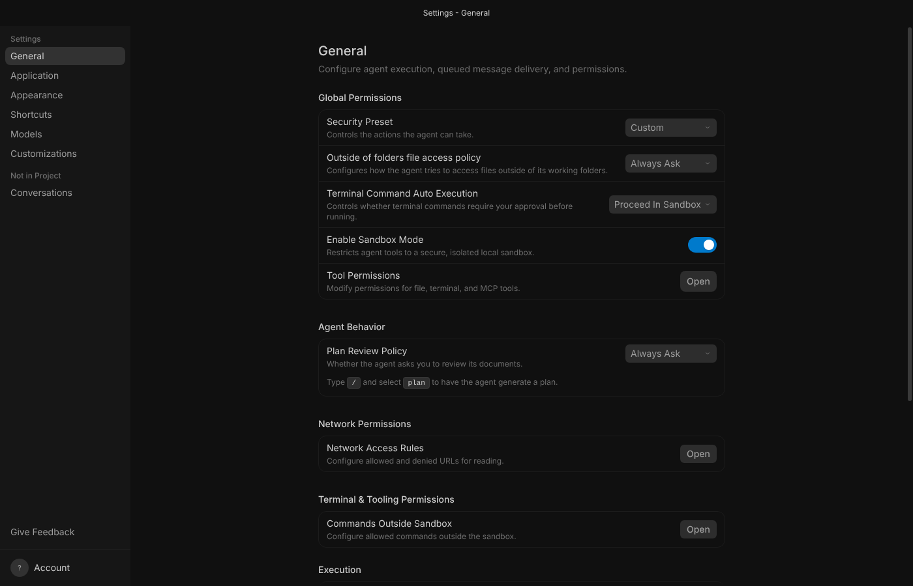
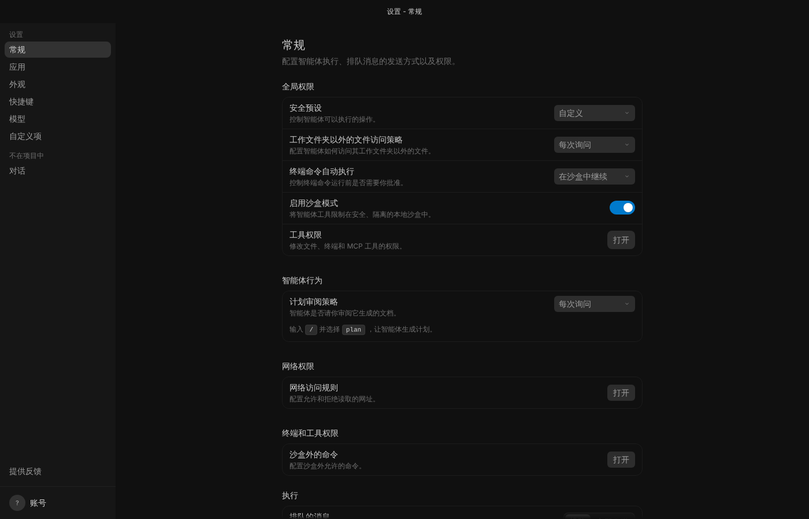
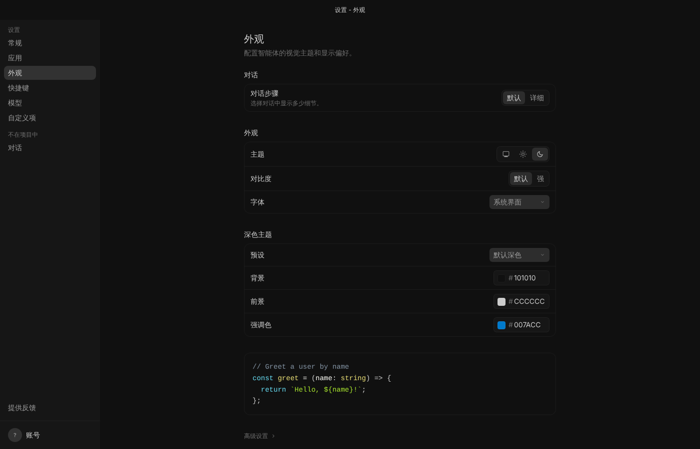
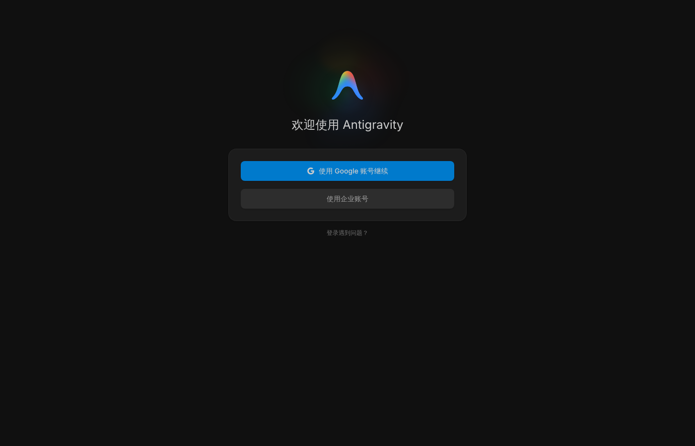
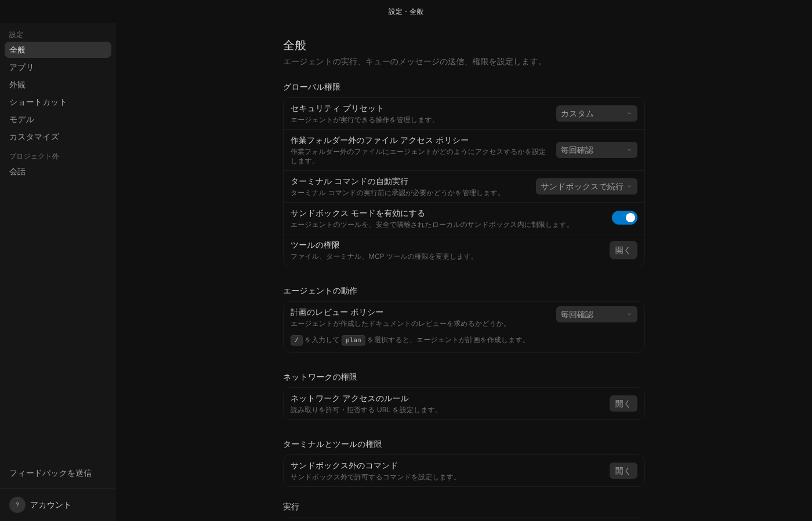

# Antigravity 中文界面（附日语版）

给 Google **Antigravity 2.x 桌面应用**加上简体中文界面，随时一键还原官方英文版。同一个工具也能装日语界面，日语说明见 [README.ja.md](README.ja.md)。

| 官方英文版 | 汉化后 |
| --- | --- |
|  |  |

<details>
<summary>更多截图</summary>





</details>

## 特点

- **按真实界面文案翻译**：词条从 Antigravity 2.29.0 官方安装包里内嵌的界面程序中逐条提取，约 3,960 条（整段文字 3,292、带变量的句式 604、夹着按钮或代码的整句 64），术语统一，见 [术语表](docs/术语表.md)。日语版收录同一批原文，另行翻译，见 [用語集](docs/用語集-ja.md)。
- **只改一个文件**：`resources\app.asar`。改之前先备份官方原版，还原后与原版逐字节一致。
- **不用装任何东西**：不需要 Node.js、Python。工具借用 Antigravity 自带的运行环境。
- **不联网**：工具和补丁都不会下载或上传任何东西。所有代码都在这个文件夹里，可以逐行看。
- **翻不准就不翻**：只做整句匹配，宁可留英文，也不拼出半中半英的句子。输入框、编辑器、终端、代码、智能体的回复、你发出的消息都不会被改动。

## 使用方法（Windows）

1. 下载这个仓库（GitHub 页面 **Code → Download ZIP**），解压到任意位置。
2. 打开 `antigravity-l10n` 文件夹，双击 **`汉化.bat`**。
   - 如果 Antigravity 正在运行，会提示先关掉它，输入 `Y` 确认（正在进行的对话会被中断）。
   - 完成后会问要不要立即打开 Antigravity。
3. 想恢复英文：双击 **`还原英文.bat`**。
4. 看看当前是什么状态：双击 **`查看状态.bat`**。

想要日语界面就双击 `日本語化.bat`（对应的还原、查看状态是 `英語に戻す.bat`、`状態を確認.bat`，提示文字是日语）。中文和日语之间可以直接切换，不用先还原。

如果 Windows 弹出“Windows 已保护你的电脑”（因为文件来自网络），点 **更多信息 → 仍要运行**；或者在解压前右键 ZIP → **属性** → 勾选 **解除锁定**。

Antigravity 默认装在 `%LOCALAPPDATA%\Programs\antigravity`，工具会自动找到。装在别处的话，用 PowerShell 手动指定（`Antigravity.exe` 所在的文件夹）：

```powershell
powershell -NoProfile -ExecutionPolicy Bypass -File scripts\agzh.ps1 -Command apply -Locale zh-CN -InstallDir "D:\Apps\Antigravity"
```

## 官方更新以后

Antigravity 自动更新时会换掉 `app.asar`，界面就会变回英文。**再双击一次 `汉化.bat`** 就行，几秒钟完成。工具会识别新版本，并把备份换成新版的官方原版。

新版本里新增的文字会先显示英文。因为是整句匹配，旧词典不会把新界面翻错。

## 哪些地方不翻 / 已知限制

- **智能体回复用什么语言**和界面汉化无关。想让它用中文回复，在 **设置 → 自定义项** 里加一条规则，比如“始终使用简体中文回复”。
- 模型名、产品名（Gemini、Claude、Google Chrome 等）、按键名（Ctrl、Shift）保持英文。
- 窗口菜单（File / Edit / View…）不翻：Windows 版本身就隐藏了菜单栏，而且官方代码是按英文名字找这些菜单的，改了会出问题。
- 在设置等页面的**搜索框**里筛选时，仍要输入英文关键词（筛选在界面程序内部按英文进行）。
- 少数句子中间嵌着按钮或变量，语序受原有排版限制，读起来可能略生硬。
- 只有 Google 内部版本才有的功能（CitC、Cog、ABFS、Piper 等）没有翻译。
- 只支持 Antigravity 2.x 桌面应用，不支持旧版 Antigravity IDE（VS Code 内核那个）。

## 测试情况

- 词典、补丁和翻译脚本都在 **Antigravity 2.29.0 官方 Linux 版**上实际运行验证：打补丁后程序正常启动，登录页、设置页的每个分页、IDE 迁移向导、托盘菜单都已检查（中文、日语两种都看过），页面没有报错。
- Windows 版 2.29.0 的 `app.asar` 和内嵌界面程序与 Linux 版**逐字节相同**（已比对官方安装包，SHA-256 与 winget 清单一致），所以补丁内容完全一样。
- `汉化.bat` 调用的 PowerShell 脚本在 PowerShell 7 上跑通了“检测运行中的程序 → 关闭 → 汉化 → 还原”的完整流程；**还没有在真正的 Windows 机器上运行过**，第一次用时请留意提示。如果出错，`还原英文.bat` 或重新安装官方 Antigravity 都能恢复原状。
- `npm test` 包含 18 项自动测试（asar 读写、补丁、备份与还原、中日切换、词典格式与两种语言的原文是否一致、主进程钩子、在 Chromium 里跑页面翻译；最后一项需要装有 playwright，没有时自动跳过）。

## 原理

Antigravity 2.x 的界面是本地 `language_server` 提供的网页，由 Electron 外壳加载。补丁在 `app.asar` 里做三处改动：

| 位置 | 改动 |
| --- | --- |
| `dist/preload.js` | 末尾追加翻译脚本和词典。它在页面加载前运行（隔离环境，页面脚本碰不到），用 `MutationObserver` 监听界面变化，把命中词典的文字换成中文。只改文字内容和 `placeholder`、`title`、`alt` 属性，不增删、不移动任何元素。 |
| `dist/main.js` | 第一行加载 `dist/agzh/main-hook.js`：给托盘菜单、右键菜单、系统对话框、系统通知套一层翻译。 |
| `dist/agzh/` | 主进程用的翻译核心、词典和补丁信息。 |

另外还有 `dist/ideInstall/wizardPreload.js`（旧版 IDE 迁移向导）也加了同样的翻译脚本。

安全方面：

- 工具只读写 `resources\app.asar` 和备份 `resources\app.asar.agzh-original` 这两个文件，写入前后都会校验。
- 如果发现 `app.asar` 已经被其他汉化工具改过，会拒绝处理，避免把别人的修改当成“原版”备份。
- 用 Antigravity 自带运行环境前，会先确认它的 Electron `RunAsNode` 开关是开着的；不是的话改用系统里的 Node.js，不会误把 Antigravity 启动起来。

## 文件说明

```
汉化.bat / 还原英文.bat / 查看状态.bat   双击入口（中文）
日本語化.bat / 英語に戻す.bat / 状態を確認.bat   双击入口（日语）
scripts/agzh.ps1                         找安装目录、关闭/重开 Antigravity、调用 cli.js
src/cli.js                               apply / restore / status（--locale zh-CN|ja，不做任何交互）
src/messages.js                          命令行提示文字（中文 / 日语）
src/patch.js                             由官方 app.asar 生成汉化版并自检
src/asar.js                              零依赖的 asar 读写
src/runtime/translator.js                翻译核心（页面和主进程共用）
src/runtime/dom.js                       页面翻译（MutationObserver）
src/runtime/main-hook.js                 主进程钩子
locales/zh-CN/*.json、locales/ja/*.json  词典
docs/术语表.md、docs/用語集-ja.md         统一的译法
tools/                                   维护词典用的工具
test/                                    自动测试
```

## 维护词典

词典在 `locales/zh-CN/`（日语在 `locales/ja/`）下，按文件名顺序合并，后面的覆盖前面的：

- `00-desktop.json`：桌面外壳（托盘、对话框、迁移向导）的文字
- `10-ui.json`：界面文字
- `20-manual.json`：手工补充（相对时间、整句规则、内置技能说明）

每个文件有三部分：

```jsonc
{
  "text":     { "Cancel": "取消" },                          // 整段文字完全一致才替换
  "patterns": { "{0} agents running": "{0} 个智能体正在运行" }, // {0}、{1} 是变量，译文可以调换顺序
  "sentences": {                                             // 句子中间夹着按钮/代码时，按整句分别指定每一段
    "Type / and select plan to have the agent generate a plan.": {
      "Type": "输入", "and select": "并选择", "to have the agent generate a plan.": "，让智能体生成计划。"
    }
  }
}
```

官方出新版本后，找出没翻译的文字：

```bash
cd tools && npm install && cd ..
node tools/extract-webui.js "%LOCALAPPDATA%\Programs\antigravity\resources\bin\language_server.exe" webui
node tools/find-untranslated.js webui/main.js untranslated.json
node tools/find-untranslated.js webui/main.js untranslated-ja.json ja
```

改完词典后运行测试，再双击 `汉化.bat` 重新生成：

```bash
npm test
```

## 许可

本项目代码与译文以 MIT 许可发布。界面英文原文的版权属于 Google。本项目与 Google 无关。

社区项目 [nianshou555qiansui/antigravity_chinese_v2](https://github.com/nianshou555qiansui/antigravity_chinese_v2) 的说明里提到界面文案都在 `main.js` 里，给了提取思路；本项目没有使用其他项目的代码或词典。
